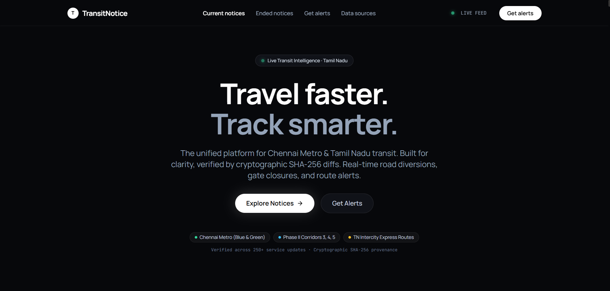
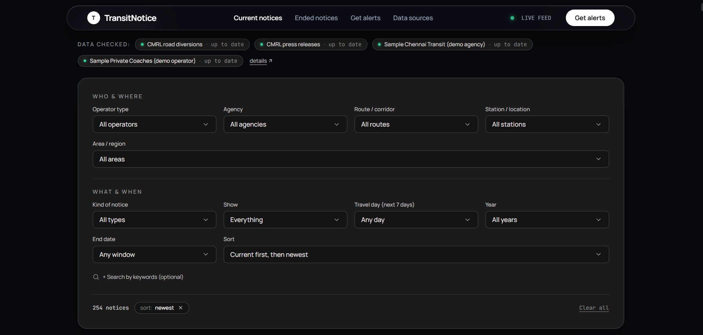
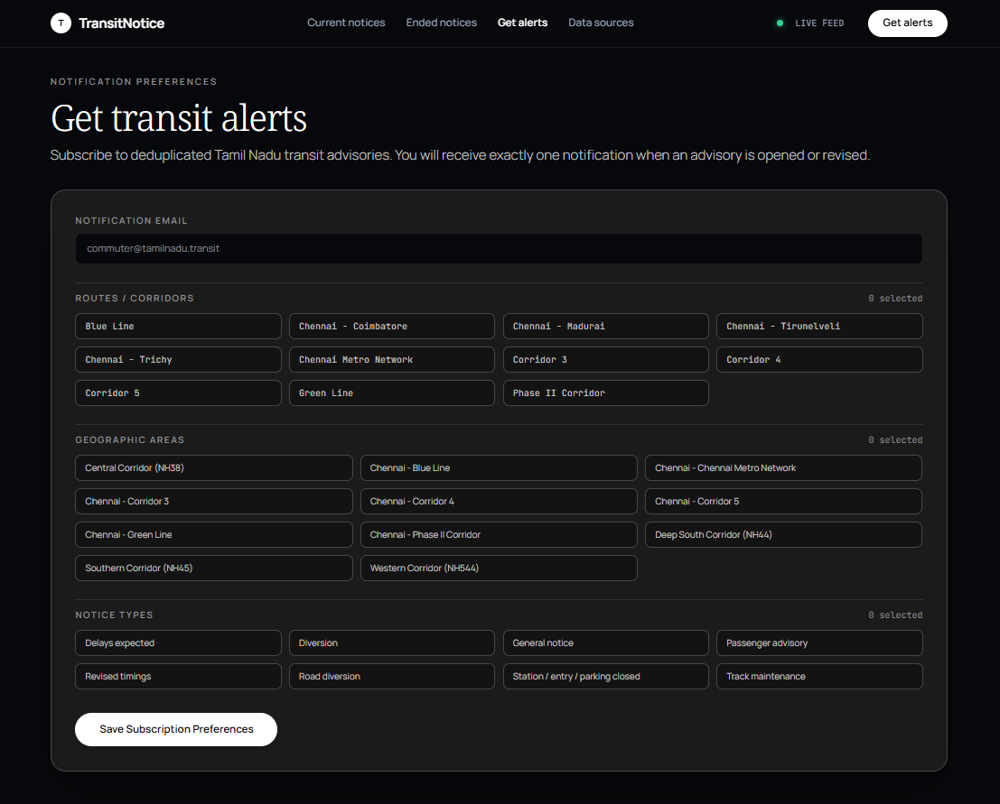
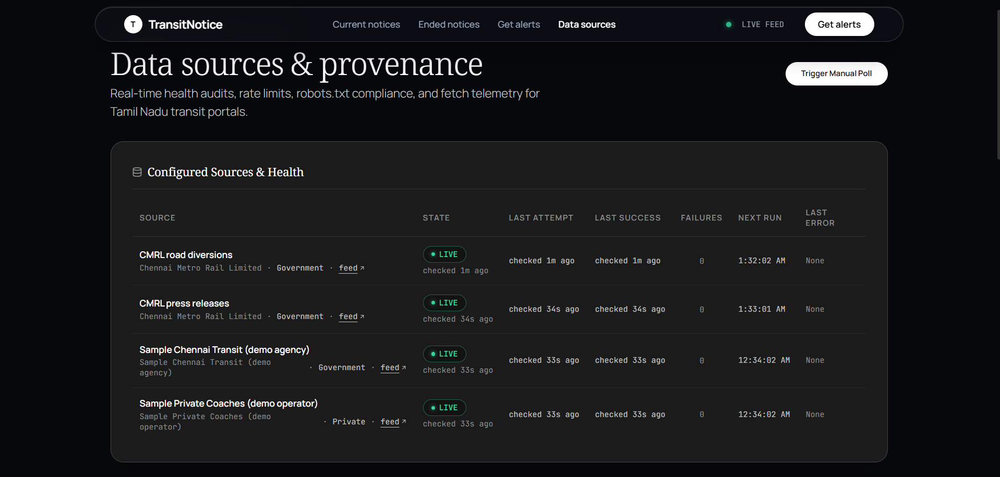
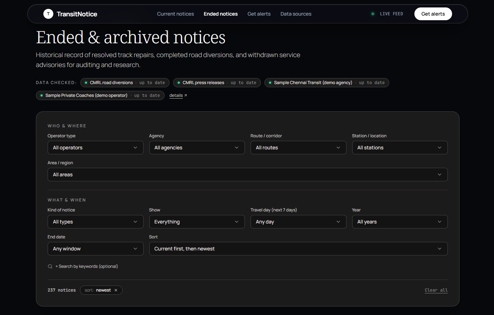

# TransitNotice (WEB-07)
### Public Transport Service Update Tracker for Tamil Nadu

[](https://www.python.org/)
[](https://flask.palletsprojects.com/)
[](https://react.dev/)
[](https://tailwindcss.com/)
[](https://www.sqlite.org/)
[](#)
[](#)

TransitNotice is a high-performance public transport advisory intelligence tracker built specifically for Tamil Nadu transit networks. It monitors **Chennai Metro Rail Limited (CMRL)** road diversions, **CMRL press releases**, intermodal metro services, and **private intercity coach routes** with real-time scraping, deduplication, and cryptographic SHA-256 change tracking.

---

## Visual Showcase

### 1. Minimalist Hero & Live Transit Tracker
> Clean, dark-mode front page featuring a fluid capsule navbar, status indicators, and instant access to verified transit updates across Chennai Metro & Tamil Nadu corridors.



### 2. Two-Section Faceted Filter Panel & Current Notices
> Granular filtering across **WHO & WHERE** (Operator, Agency, Route, Station, Area) and **WHAT & WHEN** (Notice Type, Show Status, Travel Day for next 7 days, Year, End Date, and Sort) with custom dark dropdown menus.



### 3. Notification Preferences & Alert Subscriptions
> Subscribe to deduplicated service advisories with granular corridor, station, and notice-type filters. Guarantees exactly one alert per notice revision (`UNIQUE(notice_id, revision_id, subscriber_id)`).



### 4. Data Sources, Health Audits & Scraper Telemetry
> Live provenance telemetry tracking `robots.txt` compliance, rate limiting (1 req/sec per host), consecutive failures, and HTTP outcome audits with one-click manual polling.



### 5. Ended & Archived Notices Archive
> Immutable historical audit trail of resolved track maintenance, expired road diversions, and completed service advisories with full revision history.



---

## Architecture & Technical Design

TransitNotice follows a clean, decoupled client-server architecture:

```
┌────────────────────────────────────────────────────────┐
│             Tamil Nadu Transit Feeds                   │
│   CMRL Diversions  ·  CMRL Press  ·  Private Bus RSS   │
└───────────────────────────┬────────────────────────────┘
                            │ (1 req/sec rate limit, robots.txt, SHA-256)
┌───────────────────────────▼────────────────────────────┐
│              Python Scraper & Sync Engine              │
│       Standard Library: urllib, html.parser, xml       │
└───────────────────────────┬────────────────────────────┘
                            │
┌───────────────────────────▼────────────────────────────┐
│             SQLite 3 Database (8 Tables)               │
│     notices, routes, stations, revisions, alerts       │
└───────────────────────────┬────────────────────────────┘
                            │ JSON REST API
┌───────────────────────────▼────────────────────────────┐
│            React Single Page Application               │
│       Vite · Tailwind CSS · Lucide React Icons         │
└────────────────────────────────────────────────────────┘
```

### Key Technical Highlights
- **Zero Third-Party Scraping Libraries:** Built strictly with the Python standard library (`urllib.request`, `urllib.robotparser`, `html.parser`, `xml.etree.ElementTree`, `hashlib`, `zoneinfo`, `sqlite3`, `threading`).
- **Cryptographic Provenance Diffing:** Every advisory is fingerprinted via SHA-256. Unchanged content updates only `last_confirmed_at`; content modifications automatically increment `revision_id` and generate human-readable diff logs in `notice_revisions`.
- **`robots.txt` & Rate-Limit Compliance:** Built-in fetcher respects `robots.txt` per host with 1 req/sec rate limiting, 15s–30s timeouts, and exponential backoff.
- **Fluid Morphing Capsule Navbar:** Adapts smoothly on scroll into a floating acrylic pill with 20px backdrop blur, hardware-accelerated transitions, and zero content reflow.
- **Custom Dark Dropdown Menus:** Replaces native browser `<select>` boxes with sleek dark popovers featuring checkmarks, chevron animations, and live facet counts.

---

## Monitored Transit Feeds

| Source Key | Agency / Operator | Type | URL & Format | Description |
|:---|:---|:---|:---|:---|
| `cmrl` | Chennai Metro Rail Limited | Government | REST JSON + HTML | Corridor packages (Corridors 3, 4, 5), stations, and road diversion notices. |
| `cmrl_press` | Chennai Metro Rail Limited | Government | HTML Table | Passenger advisories (station gate closures, revised timings, parking suspensions). Undated notices apply for 14 days. |
| `sample_metro` | Sample Chennai Transit | Demo Agency | Local HTML (`/demo-source/metro`) | Interactive live demo feed allowing evaluators to extend outages or inject open-ended notices. |
| `demo_private_bus` | Sample Private Coaches | Private | Local RSS XML (`/demo-source/private_coaches.xml`) | Intercity bus routes (Chennai–Coimbatore, Chennai–Madurai, Chennai–Trichy, Chennai–Tirunelveli). |

---

## 8-Table SQLite Schema

Implemented in `backend/migrations/001_init.sql`:

1. **`sources`**: Source metadata, base URLs, timezone (`Asia/Kolkata`), refresh intervals, consecutive failure counts, and last error logs.
2. **`notices`**: Primary notice storage keyed deterministically by `source_key:external_id`. Tracks agency, routes, area, status (`active`, `upcoming`, `ended`, `withdrawn`, `cancelled`), observed/confirmed timestamps, SHA-256 hash, and revision ID.
3. **`notice_routes`**: Normalized junction linking notices to affected transit lines (`PK(notice_id, route_id)`).
4. **`notice_stations`**: Normalized junction mapping notices to specific metro stations (`PK(notice_id, station)`).
5. **`notice_revisions`**: Snapshot history tracking previous content hashes, timestamps, and diff summaries whenever a notice changes.
6. **`fetch_runs`**: Scraper audit trail recording timestamps, outcome (`ok`, `error`, `blocked`), HTTP response codes, yields, and error logs.
7. **`subscribers`**: Email subscriptions with serialized JSON filter criteria.
8. **`alert_log`**: Log of sent notifications enforced by `UNIQUE(notice_id, revision_id, subscriber_id)` to guarantee zero duplicate alerts.

---

## REST API Endpoints

| Method | Endpoint | Query Parameters / Payload | Description |
|:---|:---|:---|:---|
| `GET` | `/api/notices` | `operator_type`, `agency`, `route`, `station`, `area`, `type`, `show`, `travel_day`, `year`, `end_date`, `sort`, `q` | Returns filtered notices, facet counters, and source summaries. |
| `GET` | `/api/notices/<notice_id>` | — | Returns full notice details, stations list, affected routes, and revision history. |
| `GET` | `/api/sources` | — | Returns all configured sources, health states (`LIVE`, `STALE`, `ERROR`), and run telemetry. |
| `POST` | `/api/sync` | `Authorization: Bearer <token>` | Triggers on-demand synchronization across all transit sources. |
| `GET` | `/api/alerts/options` | — | Returns available filter options (routes, stations, areas, types) for subscriptions. |
| `POST` | `/api/alerts/subscribe` | `{"email": "...", "filters": {...}}` | Registers a new alert subscription. |
| `POST` | `/api/demo/metro/mutate` | `{"action": "extend_24h" \| "open_ended" \| "simulate_503" \| "recover" \| "reset"}` | Live mentor testing endpoint for state mutations. |
| `GET` | `/favicon.ico` | — | Returns `204 No Content` to prevent browser icon caching. |

---

## Quickstart & Installation

### Option 1: One-Click Startup (Windows)
Double-click or run:
```cmd
start.bat
```
*`start.bat` automatically verifies Python 3.10+, installs required packages, initializes the SQLite database, detects the pre-built React frontend, and launches the server at `http://127.0.0.1:5000/`.*

### Option 2: Manual Setup

1. **Clone the repository:**
   ```bash
   git clone https://github.com/KARTHICK-3056/TransitNotice.git
   cd TransitNotice
   ```

2. **Install backend dependencies:**
   ```bash
   pip install -r backend/requirements.txt
   ```

3. **Initialize the database:**
   ```bash
   python -c "from backend.db import init_db; init_db()"
   ```

4. **Build the frontend (Node.js 18+):**
   ```bash
   cd frontend
   npm install
   npm run build
   cd ..
   ```
   *(Note: The repository already includes a pre-compiled `frontend/dist/` bundle so you can skip this step if Node.js is not installed).*

5. **Start the Flask server:**
   ```bash
   python -m backend.app
   ```
   Open **`http://127.0.0.1:5000/`** in your browser.

---

## Automated Acceptance Test Suite

Run all automated unit tests covering the core WEB-07 requirements:

```bash
python -m unittest discover -s backend/tests -p "test_*.py" -v
```

### Verified Test Cases:
- `test_1_expired_notice_never_marked_active`: Notices with `valid_to` in the past are always computed as `ended`, never `active`.
- `test_2_multi_route_filtering`: Multi-line notices (e.g. `Blue Line, Green Line`) match queries for each route.
- `test_3_extended_outage_bumps_revision_and_change_summary`: Extending an advisory window increments `revision_id` and logs human-readable diffs in `notice_revisions`.
- `test_4_ist_datetime_and_open_ended_support`: Open-ended notices (`valid_to = NULL`) parse cleanly without date bounds errors.
- `test_5_source_outage_503_preserves_last_confirmed_at`: Upstream 503 errors preserve existing notices and freeze `last_confirmed_at` timestamps.
- `test_6_single_alert_deduplication`: `UNIQUE(notice_id, revision_id, subscriber_id)` guarantees at most 1 alert per revision.

---

## Project Structure

```
TransitNotice/
├── backend/
│   ├── app.py                      # Flask API & static file server
│   ├── config.py                   # Environment & timezone configuration
│   ├── db.py                       # SQLite connection helpers & schema initializers
│   ├── requirements.txt            # Minimal backend dependencies (Flask, flask-cors, tzdata)
│   ├── transitnotice_tn.db         # Pre-seeded SQLite database with live CMRL notices
│   ├── agencies.json               # Seed metadata for configured transit operators
│   ├── migrations/
│   │   └── 001_init.sql            # Exact 8-table SQLite schema
│   ├── services/
│   │   ├── alert_service.py        # Subscriber management & alert dispatching
│   │   ├── hashing.py              # Deterministic SHA-256 fingerprinting & diffs
│   │   └── sync_engine.py          # Unified synchronization engine with rate limiter
│   ├── sources/
│   │   ├── base.py                 # robots.txt compliant fetcher & base parser
│   │   ├── cmrl_diversions.py      # CMRL road diversions scraper
│   │   ├── cmrl_press.py           # CMRL press releases table scraper (14-day rule)
│   │   ├── sample_metro.py         # Mentor interactive demo HTML feed
│   │   └── demo_private_bus.py     # Private intercity coach RSS XML feed
│   └── tests/
│       └── test_acceptance.py      # Full 6-test automated acceptance suite
├── frontend/
│   ├── dist/                       # Pre-compiled production bundle (zero-node deployment)
│   ├── src/
│   │   ├── App.jsx                 # Client-side router & main application layout
│   │   ├── api.js                  # Fetch wrapper for Flask JSON endpoints
│   │   ├── index.css               # Obsidian/Vercel dark-slate theme styles
│   │   ├── components/
│   │   │   ├── CustomSelect.jsx    # Custom dark dropdown component
│   │   │   ├── FilterPanel.jsx     # 2-section faceted filter container
│   │   │   ├── Navbar.jsx          # Morphing acrylic capsule navigation bar
│   │   │   ├── NoticeCard.jsx      # Elevated dark advisory card with provenance
│   │   │   └── SourceBadges.jsx    # Live data checked status pills
│   │   └── views/
│   │       ├── AlertsView.jsx      # Notification preferences & subscription view
│   │       ├── CurrentNoticesView.jsx # Hero & active notices list
│   │       ├── EndedNoticesView.jsx# Historical archived notices
│   │       ├── NoticeDetailView.jsx# Deep notice audit with revision history
│   │       └── SourcesView.jsx     # Data sources telemetry & health audits
│   ├── package.json
│   └── vite.config.js
├── screenshots/                    # High-resolution application screenshots (1.png - 5.png)
├── docs/                           # Specification documents & SRS
├── .env.example                    # Environment template
├── .gitignore                      # Git ignore rules
├── pytest.ini                      # Pytest test configuration
├── requirements.txt                # Root requirements pointer
└── start.bat                       # One-click Windows launch script
```

---

## License

Distributed under the MIT License. See [LICENSE](LICENSE) for more details.
