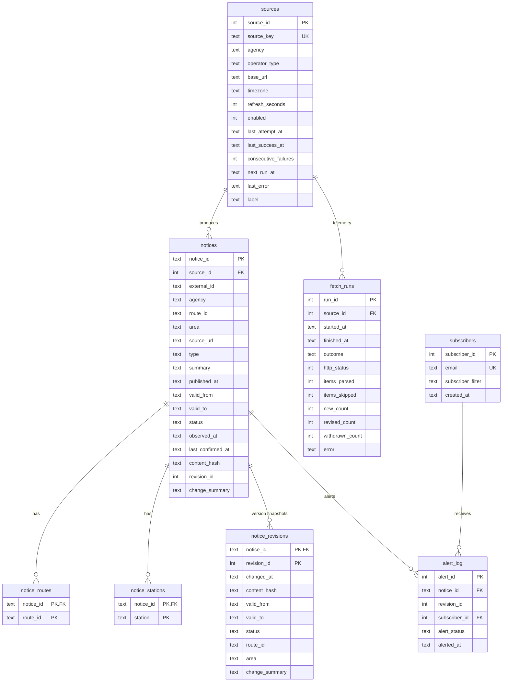

# TransitNotice: Source Approval & Software Requirements Specification (SRS)
**Project Code:** WEB-07 (Public Transport Service Update Tracker for Tamil Nadu)  
**System Classification:** Decoupled Provenance-Enforced Event Sourcing & Change Detection Engine  
**Version:** 2.0.0 (Tamil Nadu Production Specification)

---

## 1. Executive Summary & Problem Formulation
Official transit authorities across Tamil Nadu—principally **Chennai Metro Rail Limited (CMRL)** and regional omnibus services—post, modify, and withdraw road diversions, station closures, and service updates across disconnected HTML portals and press release bulletin tables. Commuters and operations teams face three critical challenges:
1. **Silent Modifications:** Advisories are silently extended by 24–48 hours, or affected detour routes change without a clear revision log.
2. **Alert Fatigue:** Commuters subscribing to notifications receive repeat, duplicate alerts every time an automated tool polls unchanged advisories.
3. **False Freshness ("Stale Snapshots"):** Scrapers that encounter upstream 500/503 errors often refresh their local database timestamps, deceiving downstream riders into believing an advisory was verified live when the transit portal was actually down.

**TransitNotice** solves these challenges using an ethical, standard-library Python scraper engine, SHA-256 content hashing, version-aware diffing, strict provenance verification, idempotent alert dispatching, and a minimal Linear/Vercel-inspired dark-mode React frontend.

---

## 2. User Personas

### Persona 1: Daily Multimodal Commuter
- **Name:** Karthik Sundaram
- **Role:** Commuter (Senior Embedded Systems Engineer, OMR IT Corridor)
- **Commute:** Metro Blue Line from Washermanpet to Guindy, connecting via private intercity coach to Trichy on weekends.
- **Goals:**
  - Needs unambiguous confirmation if Guindy station gates or parking are closed or if Arcot Road diversions affect bus shuttles.
  - Wants zero spam alerts: alerts must trigger *only* when an incident is newly opened or when its duration or detour routes are meaningfully changed.
  - Needs clear visibility of "Open-Ended / Until Further Notice" incidents versus fixed-duration closures.

### Persona 2: Transit Operations Dispatcher
- **Name:** Meenakshi Raman
- **Role:** Chennai Transit Operations Command Center (TOCC) Senior Dispatcher
- **Responsibilities:**
  - Manages intermodal feeder services, detour bus routes around Phase II underground metro construction, and passenger notifications.
- **Goals:**
  - Requires a full historical audit trail (`v1`, `v2`, `v3`) with SHA-256 hashes proving exactly when a contractor extended an outage window.
  - Demands strict provenance: if an upstream external agency portal suffers a 503 outage, the UI must immediately flag data as `ERROR` and freeze `last_confirmed_at` so operations does not make fleet decisions based on unverified stale data.

---

## 3. Data Sources & Scraping Methodology

Scrapers rely exclusively on Python standard-library modules (`urllib.request`, `urllib.robotparser`, `html.parser`, `xml.etree.ElementTree`):

1. **CMRL Road Diversions (`cmrl` - Government, Live):**
   - Source: `https://chennaimetrorail.org/wp-json/wp/v2/road-diversion`
   - Content: Corridor 3, 4, and 5 traffic diversions, affected stations, and start dates.
2. **CMRL Press Releases (`cmrl_press` - Government, Live):**
   - Source: `https://chennaimetrorail.org/press-release/`
   - Content: HTML table containing passenger advisories (parking closures, special match services, revised timings).
3. **Sample Chennai Transit (`sample_metro` - Demo Agency):**
   - Source: `http://127.0.0.1:5000/demo-source/metro`
   - Content: HTML portal for live mentor testing (+24h extension, open-ended notices).
4. **Sample Private Coaches (`demo_private_bus` - Demo Operator):**
   - Source: `http://127.0.0.1:5000/demo-source/private_coaches.xml`
   - Content: XML RSS feed of Tamil Nadu intercity private bus corridors (NH544, NH45, NH38, NH44).

---

## 4. `robots.txt` Compliance Policy
TransitNotice enforces ethical, standards-compliant scraping via `urllib.robotparser`:
1. **Pre-Flight Check:** Prior to fetching any external URL, the scraper extracts `scheme://netloc/robots.txt` and caches the rule set.
2. **Custom User-Agent:** The scraper identifies itself with a transparent User-Agent string:
   `TransitNoticeBot/1.0 (+https://github.com/transitnotice; compliance@transitnotice.local)`
3. **Disallow Enforcement:** If `robots.txt` disallows the user agent (401, 403, 5xx), the scraper halts execution immediately, logs an audit record, and refuses to scrape. 404 is treated as allow all.
4. **Rate Limiting:** Enforces strict 1 req/sec per host rate limiting.

---

## 5. System Architecture & Entity-Relationship (ER) Model

